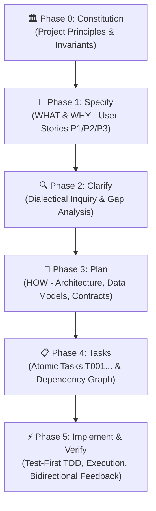

# 📐 Specification-Driven Development (SDD) — GitHub Spec Kit Framework

Derived from **GitHub Spec Kit (`github/spec-kit`)**, this skill embeds the comprehensive cognitive framework and engineering discipline for building robust software systems. It eliminates "vibe coding" (ad-hoc speculative prompting) and establishes **executable specifications** as the single source of truth across all projects.

---

## 🏛️ I. THE POWER INVERSION (TRIẾT LÝ ĐẢO NGƯỢC QUYỀN LỰC)

> **"Code does not dictate specifications; code serves specifications."**

1. **Specifications as Primary Assets**: Product Requirements Documents (PRD), Architecture Blueprints, Data Models, and API Contracts are not disposable scaffolding—they are **executable definitions** that generate and govern code.
2. **Elimination of the Implementation Gap**: When specifications and technical plans are precise, unambiguous, and testable, there is no guesswork—only systematic transformation into working software.
3. **Intent-Driven Engineering**: Software intent is expressed in natural language, domain models, acceptance criteria (Given/When/Then), and architectural principles. Code is the last-mile expression in a specific framework or language.
4. **Maintenance by Spec Evolution**:
   - Debugging means fixing specifications and technical plans that produced incorrect code.
   - Refactoring means restructuring specifications for modularity and clarity.
   - New features mean evolving the spec first, then regenerating or extending tasks.

---

## 🔄 II. THE 6-PHASE SDD LIFECYCLE (VÒNG ĐỜI PHÁT TRIỂN 6 BƯỚC)

---

### 🏛️ Phase 0: Project Constitution (`/constitution` / `constitution.md`)
**Mục tiêu:** Thiết lập "Hiến pháp dự án" — các nguyên tắc kiến trúc bất di bất dịch, chuẩn mực kiểm thử, và ràng buộc quản trị.
- **Vị trí file:** `.specify/constitution.md` hoặc `specs/constitution.md`.
- **Nội dung bắt buộc:**
  1. **Core Principles:** Thư viện độc lập (Library-First), Giao diện dòng lệnh/API chuẩn (CLI/API Protocol), Kiểm thử trước (Test-First/TDD), Khả năng quan sát (Observability/Logging).
  2. **Security & Performance Standards:** Chuẩn mã hóa, xác thực, độ trễ tối đa (p95 latency), hạn mức bộ nhớ.
  3. **Governance & Amendments:** Mọi Pull Request / Task thực hiện phải đối chiếu và tuân thủ Hiến pháp.

---

### 📝 Phase 1: Feature Specification (`/specify` / `spec.md`)
**Mục tiêu:** Định nghĩa rõ ràng **WHAT** (Làm cái gì) và **WHY** (Tại sao phải làm), tuyệt đối chưa bàn về HOW (Code như thế nào).
- **Vị trí file:** `specs/[###-feature-name]/spec.md`.
- **Cấu trúc chuẩn:**
  1. **Feature Summary & Business Goals:** Mục đích kinh doanh, bối cảnh sử dụng.
  2. **Prioritized User Stories (P1, P2, P3...):**
     - Mỗi User Story phải là một lát cắt dọc (Vertical Slice) **độc lập có thể kiểm thử riêng biệt (Independently Testable)**.
     - P1 là cốt lõi (MVP) có thể demo độc lập; P2, P3 bổ sung giá trị gia tăng.
  3. **Acceptance Criteria (Gherkin format):**
     - `Given [trạng thái ban đầu], When [hành động kích hoạt], Then [kết quả mong đợi]`.
  4. **Domain Entities & Scope Boundaries:** Các thực thể dữ liệu chính và ranh giới rõ ràng điều gì NẰM NGOÀI PHẠM VI (Out-of-Scope).

---

### 🔍 Phase 2: Clarification & Dialectical Inquiry (`/clarify`)
**Mục tiêu:** Chủ động phản biện, bóc tách các giả định ngầm định, phát hiện điểm mơ hồ (ambiguities), ca biên (edge cases), và kịch bản lỗi *trước khi* bắt tay vào thiết kế kỹ thuật.
- **Quy trình thực hiện:**
  1. Rà soát `spec.md` tìm các lỗ hổng: dữ liệu null/rỗng, tải lớn, lỗi mạng/timeout, tương thích ngược.
  2. Đặt câu hỏi trắc nghiệm hoặc làm rõ có trọng tâm cho người dùng.
  3. Cập nhật trực tiếp các câu trả lời vào `spec.md` để hoàn thiện tài liệu đặc tả.

---

### 📐 Phase 3: Architectural & Technical Planning (`/plan` / `plan.md`)
**Mục tiêu:** Chuyển hóa đặc tả nghiệp vụ thành giải pháp kỹ thuật cụ thể (**HOW**).
- **Vị trí file:** `specs/[###-feature-name]/plan.md`.
- **Nội dung bắt buộc:**
  1. **Technical Context:** Ngôn ngữ, framework, thư viện, cơ sở dữ liệu, mục tiêu hiệu năng.
  2. **Constitution Check:** Đánh giá độ tương thích với Hiến pháp dự án.
  3. **Supporting Artifacts:**
     - `data-model.md`: Định nghĩa thực thể, bảng, kiểu dữ liệu, quan hệ.
     - `contracts/`: Hợp đồng API (OpenAPI, GraphQL, Protobuf, TypeScript/Pydantic schemas).
     - `quickstart.md`: Kịch bản kiểm thử tích hợp đầu cuối (End-to-End verification).
     - `research.md`: Ghi chép lý do lựa chọn công nghệ và đánh đổi kỹ thuật (trade-offs).

---

### 📋 Phase 4: Executable Task Derivation (`/tasks` / `tasks.md`)
**Mục tiêu:** Phân rã kế hoạch thành danh sách các công việc nguyên tử (Atomic Tasks), tuần tự, có thể chạy song song hoặc độc lập.
- **Vị trí file:** `specs/[###-feature-name]/tasks.md`.
- **Cú pháp định dạng:** `[ID] [P?] [Story?] Description (Files)`
  - `[P]`: Có thể chạy song song (Parallelizable - không phụ thuộc file hay kết quả của task khác).
  - `[Story]`: Gắn với User Story cụ thể (e.g. `[US1]`, `[US2]`).
- **Phân kỳ thực thi (Execution Phases):**
  - **Phase 1: Setup:** Cấu trúc thư mục, dependencies, cấu hình môi trường.
  - **Phase 2: Foundational:** Hạ tầng cốt lõi, schemas, contracts dùng chung.
  - **Phase 3: User Story Implementation (Theo thứ tự P1 ➔ P2 ➔ P3):**
    - Task viết kiểm thử (Test task) ➔ Task viết logic (Implementation task).
  - **Phase 4: Polish & Integration:** Tối ưu hóa, kiểm thử E2E, tài liệu hướng dẫn.

---

### ⚡ Phase 5: Implementation & Verification (`/implement`, `/verify`)
**Mục tiêu:** Thực thi từng task theo đúng thứ tự, kiểm chứng kết quả theo tiêu chí nghiệm thu.
- **Kỷ luật Test-First (TDD):**
  1. Viết bài test dựa trên Acceptance Criteria trong `spec.md`.
  2. Chạy test và xác nhận test FAIL (Red).
  3. Viết code tối thiểu để test PASS (Green).
  4. Refactor giữ nguyên hành vi kiểm thử.
- **Bidirectional Feedback Loop:** Khi phát hiện bất cập trong mã thực tế (ví dụ API chậm, thư viện không tương thích), lập tức cập nhật ngược lại vào `plan.md` và `spec.md`.

---

## 📁 III. TEMPLATES & ARTIFACT DIRECTORY

Các mẫu tài liệu chuẩn của Spec Kit được đính kèm sẵn trong thư mục kỹ năng:
- **Hiến pháp dự án:** [`./templates/constitution-template.md`](./templates/constitution-template.md)
- **Đặc tả tính năng:** [`./templates/spec-template.md`](./templates/spec-template.md)
- **Kế hoạch kỹ thuật:** [`./templates/plan-template.md`](./templates/plan-template.md)
- **Danh sách nhiệm vụ:** [`./templates/tasks-template.md`](./templates/tasks-template.md)
- **Bảng kiểm định:** [`./templates/checklist-template.md`](./templates/checklist-template.md)
- **Chi tiết luận đề SDD:** [`./references/spec-driven.md`](./references/spec-driven.md)

---

## 🎯 IV. NGUYÊN TẮC ÁP DỤNG TRONG GIAO TIẾP VÀ LẬP TRÌNH

Khi người dùng giao bất kỳ yêu cầu phát triển phần mềm nào:
1. **Không "Vibe Code":** Tuyệt đối không đoán mò cấu trúc hoặc vội vã viết hàng trăm dòng code khi chưa có Spec và Plan rõ ràng.
2. **Khởi tạo đúng cấu trúc:** Tạo thư mục `specs/[feature-name]/` hoặc phác thảo Specification rõ ràng trước khi code.
3. **Phản biện đa chiều:** Khi thấy yêu cầu thiếu thông tin (ví dụ xử lý lỗi, ngưỡng hiệu năng, T+2.5, kiểu dữ liệu), lập tức kích hoạt bước **Clarify** để làm rõ.
4. **Cam kết tính toàn vẹn:** Mọi dòng code sinh ra phải liên kết trực tiếp với một Task trong `tasks.md` và một Acceptance Scenario trong `spec.md`.
