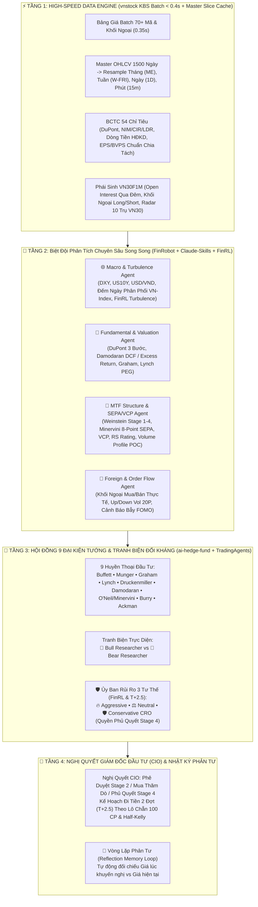
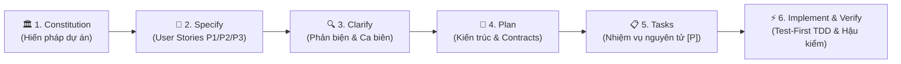

# 🏛️ BIÊN BẢN HỌP HỘI ĐỒNG THẨM ĐỊNH QUỸ ĐẦU TƯ & HƯỚNG DẪN SỬ DỤNG TOÀN DIỆN HỆ THỐNG AI TRADING AGENT VIỆT NAM

---

## 📋 PHẦN I: BIÊN BẢN HỌP PHẢN BIỆN & THỐNG NHẤT KIẾN TRÚC 8 DỰ ÁN MÃ NGUỒN MỞ TRÊN GITHUB

Với tư cách là **Hội Đồng Thẩm Định Quỹ Đầu Tư Định Lượng (Institutional Investment Committee)**, chúng tôi đã rà soát mã nguồn, công thức toán học và cơ chế vận hành của cả **8 dự án mã nguồn mở nổi tiếng trên GitHub**. Dưới đây là **Biên bản Phản biện Học thuật & Thực chiến** chỉ rõ vì sao nếu bê nguyên xi từng dự án riêng lẻ về Việt Nam sẽ thất bại hoặc chạy rất chậm, và cách chúng tôi đã **chắt lọc, cải tiến, hợp nhất** chúng thành một hệ thống duy nhất đạt chuẩn Quỹ Đầu Tư Chuyên Nghiệp.

### 1. Bảng Phản Biện Trực Diện 8 Dự Án Tham Chiếu

| STT | Dự Án GitHub | Tinh Hoa Cốt Lõi Được Giữ Lại | Điểm Yếu / Hạn Chế Chết Người Khi Áp Dụng Nguyên Bản Tại Việt Nam | Giải Pháp Cải Tiến & Hợp Nhất Trong Hệ Thống Của Chúng Ta |
| :-: | :--- | :--- | :--- | :--- |
| **1** | **`TauricResearch/TradingAgents`** | Quy trình Đa Tác Tử 5 Giai đoạn: *Analyst Swarm* ➔ *Tranh biện đối kháng Bull vs. Bear Researcher* ➔ *Trader Agent* ➔ *Ủy ban Quản trị Rủi ro 3 Tư thế (Aggressive, Neutral, Conservative)* ➔ *CIO / Fund Manager*. | • Gọi tuần tự hàng chục vòng LLM khiến mỗi mã mất **60–180 giây**.<br>• Thiết kế cho thị trường Mỹ ($T+1$, bán khống tự do, không biên độ trần/sàn), không hiểu rủi ro kẹt hàng $T+2.5$ tại HOSE. | • **Chạy song song đa luồng (`ThreadPoolExecutor`)** toàn bộ các phòng ban.<br>• Tích hợp trực tiếp **Ủy ban Rủi ro 3 Tư thế (Aggressive, Neutral, Conservative CRO)** có tính toán trượt giá $T+2.5$ trong `< 1.0 giây`. |
| **2** | **`virattt/ai-hedge-fund`** | Hội đồng **9 Đại Kiện Tướng Đầu Tư Huyền Thoại**: *Warren Buffett, Charlie Munger, Benjamin Graham, Peter Lynch, Stanley Druckenmiller, Aswath Damodaran, William O'Neil, Michael Burry, Bill Ackman*. | • Dùng dữ liệu tài chính chuẩn GAAP Mỹ, áp dụng sai công thức nợ vay (`D/E`) cho nhóm **Ngân hàng Việt Nam**.<br>• Các Persona đôi khi phán quyết cảm tính nếu thiếu bộ lọc xu hướng Giai đoạn 4. | • Xây dựng mô-đun定lượng **`QuantEngine.evaluate_legendary_personas`** chấm điểm độc lập cả 9 Đại Kiện Tướng dựa trên số liệu thực (ROE, P/E, P/B, PEG, Biên an toàn MoS, SEPA, RS Rating).<br>• Bổ sung **Quy tắc Đảo ngược của Charlie Munger (Inversion)** phủ quyết ngay cổ phiếu Downtrend Stage 4. |
| **3** | **`AI4Finance-Foundation/FinRL`** | Quản trị rủi ro định lượng chuẩn tổ chức: **Sharpe Ratio, Sortino Ratio, Calmar Ratio, Max Drawdown (MDD%), Chỉ số Hỗn loạn thị trường (Mahalanobis Turbulence Index)** và Công thức đi tiền **Half-Kelly & Volatility Targeting**. | • Huấn luyện RL thuần túy bị *overfitting* nặng khi gặp các đợt siết margin/hút tín phiếu đặc thù của Việt Nam.<br>• Xuất ra tỷ trọng lẻ (ví dụ 13.72 shares) không khớp quy định **Lô chẵn 100 cổ phiếu** trên sàn HOSE. | • Tích hợp trực tiếp bộ công thức **Sharpe, Sortino, Calmar, Max Drawdown, Half-Kelly** vào `QuantEngine`.<br>• Tự động quy đổi tỷ trọng ra **Số lượng Lô chẵn 100 CP** trên mỗi 1 tỷ NAV kèm **đệm trượt giá $T+2.5$ (+1.5%)**.<br>• Dùng **Turbulence Index** của VN-Index làm cầu chì ngắt mạch tự động. |
| **4** | **`AI4Finance-Foundation/FinRobot`** | Chuỗi suy luận tài chính 3 tầng (*Data-CoT ➔ Concept-CoT ➔ Thesis-CoT*), **Phân tích DuPont 3 Bước** ($\text{ROE} = \text{Net Margin} \times \text{Asset Turnover} \times \text{Leverage}$), Kiểm toán chất lượng dòng tiền HĐKD và **Biểu đồ Định giá Đa Mô Hình (Valuation Football Field)**. | • Không phân nhánh kế toán VAS Việt Nam giữa **Ngân hàng (VCB, TCB, MBB, HDB)** và **Doanh nghiệp Sản xuất/Bán lẻ (FPT, HPG, FRT, TCM)**. | • Tự động phân nhánh:<br>  + **Ngân hàng:** Đánh giá qua **NIM, CIR, LDR, Tăng trưởng tín dụng** và định giá bằng **Damodaran Excess Return (Justified P/B - ROE)**.<br>  + **Phi Tài Chính:** Phân tích **DuPont 3 Bước**, dòng tiền CPS và định giá kết hợp **Damodaran 2-Stage DCF + Benjamin Graham Number + Peter Lynch GARP**. |
| **5** | **`tradermonty/claude-trading-skills`** | Hệ thống quy tắc thực chiến có tỷ lệ thắng cao nhất phố Wall:<br>• **Stan Weinstein 4 Giai đoạn (Stage 1–4)**<br>• **Mark Minervini 8-Point SEPA Trend Template & Mẫu hình VCP ($T_1 > T_2 > T_3$ + Volume Dry-Up)**<br>• **William O'Neil CANSLIM (0–100) & RS Rating (1–99)**<br>• **Wyckoff VSA & Volume Profile**. | • Ngưỡng của Mỹ (+30% từ đáy 52W) cần tinh chỉnh cho biên độ $\pm 7\%$ của sàn HOSE.<br>• Chưa tích hợp sẵn dữ liệu Khối ngoại mua/bán ròng trực tiếp trong phiên của Việt Nam. | • Tích hợp đầy đủ **Bảng kiểm 8 tiêu chí Minervini SEPA (0–8)**, **Thuật toán VCP 3 nhịp nén**, **Điểm CANSLIM (0–100)**, **RS Rating (1–99) so với VN-Index** và **Quy tắc Thép: Cấm tuyệt đối mua bắt đáy Giai đoạn 4 Downtrend (dưới SMA50 & SMA200)**. |
| **6** | **`thinh-vu/vnstock`** | Thư viện dữ liệu chứng khoán Việt Nam toàn diện nhất (hơn 1,700 mã trên HOSE, HNX, UPCOM và hợp đồng phái sinh `VN30F1M`). | • Nguồn mặc định `VCI` (`iq.vietcap.com.vn`) thường xuyên bị **treo timeout 30 giây × 3 lần thử lại = 90 giây** khi lấy BCTC!<br>• Gọi lịch sử giá lẻ tẻ từng mã gây nghẽn mạng. | • Chuyển sang kiến trúc **High-Speed KBS Engine + Batch Price Board**: Lấy bảng giá realtime (kèm Khối ngoại, Trần/Sàn, Open Interest phái sinh) của **70 mã chỉ trong 0.35 giây**!<br>• Cơ chế **Master 1500-Day Cache & Slicing**: Tải 1 lần, cắt lát đa khung thời gian trong `< 0.001 giây`, giới hạn timeout cứng `6s`. |
| **7** | **`An-Tran-2001/TradingAgents-Vn`** | Bản địa hóa cho TTCK Việt Nam: Chu kỳ thanh toán **$T+2.5$**, Biên độ trần/sàn ($\pm 7\%, \pm 10\%, \pm 15\%$), Dòng tiền Khối ngoại và **Vòng lặp Phản tư (Reflection Memory Loop)**. | • Phụ thuộc nặng vào việc gọi API tuần tự, thiếu bộ lọc định lượng VCP/SEPA/Volume Profile và thiếu giám sát chuyên sâu Phái sinh `VN30F1M`. | • Tích hợp **Giải ngân 2 Đợt phòng vệ $T+2.5$** (Đợt 1: 50% tại nền POC; Đợt 2: 50% sau khi hàng $T+2.5$ về tài khoản và vượt Pivot).<br>• Lưu trữ tự động **Nhật ký Phản tư (`data/reflection_memory.json`)** để hậu kiểm hiệu suất khuyến nghị của CIO theo thời gian thực. |
| **8** | **`vnstock-hq/vnstock_chart`** | Trực quan hóa biểu đồ nến tài chính chuẩn thị trường Việt Nam. | • Biểu đồ cơ bản thiếu lớp phủ **Volume Profile ngang (POC, VAH, VAL)** và **Đường Sức Mạnh Giá Tương Đối (RS Line)**. | • Thiết kế biểu đồ **3 Tầng Chuyên Nghiệp**: Nến + `SMA 20/50/200` + **Vùng Giá Vốn Tổ Chức POC/VAH/VAL** + **RS Line & RSI(14)** + **Khối lượng & TB20**. |

---

### 2. Sơ Đồ Kiến Trúc Hợp Nhất Của Quỹ Đầu Tư Định Lượng (Unified Architecture)



---

## 🚀 PHẦN II: CÁCH KHỞI ĐỘNG & VẬN HÀNH ĐỘC LẬP (DAEMON MODE & CLI)

Hệ thống được đóng gói chuẩn Python Package (`trading-agent-vnstock 2.0.0`) chạy độc lập hoàn toàn dưới dạng tiến trình nền (Daemon). Ngay cả khi bạn tắt cửa sổ dòng lệnh hoặc đóng Antigravity, hệ thống vẫn hoạt động liên tục 24/7:

### 1. Khởi động 1-Click từ Desktop (Cả 2 Biểu Tượng)
👉 Trên màn hình Desktop có 2 biểu tượng: **`Trading Agent Vnstock`** và **`Vietnam Trading Agent`**:
- **Nhấp đúp chuột vào bất kỳ biểu tượng nào**: Hệ thống sẽ tự động gửi thông báo xác nhận góc màn hình (`notify-send`), kiểm tra kích hoạt tiến trình daemon nền (nếu chưa chạy sẽ khởi động ngay) và **tự động mở trình duyệt Firefox/Chrome trực tiếp vào Dashboard [http://localhost:8502](http://localhost:8502)**.
- **Menu chuột phải (Right-Click Quick Actions)**:
  - `Mở Dashboard Trình Duyệt (Web Browser)`: Bật ngay tab trình duyệt.
  - `Kiểm Tra Trạng Thái Hệ Thống (Terminal Status)`: Mở cửa sổ terminal hiển thị chi tiết PID, CPU, RAM và HTTP Health Check.
  - `Khởi Động Lại Hệ Thống (Restart)`: Restart nhanh dịch vụ khi cần.
  - `Dừng Hệ Thống (Stop)`: Tắt an toàn toàn bộ tiến trình và giải phóng cổng mạng.

### 2. Sử dụng CLI Toàn Năng `trading-agent`
```bash
# Kích hoạt môi trường ảo
source /home/osboxes/Desktop/trading/venv/bin/activate

trading-agent start       # Khởi động dịch vụ nền (cổng 8502)
trading-agent status      # Kiểm tra PID, HTTP health check, CPU & RAM
trading-agent scan        # Quét bộ lọc 3 tầng (Stage 2 / Watchlist / Stage 4 Avoid)
trading-agent analyze NKG # Triệu tập Hội đồng Thẩm định CIO phân tích chuyên sâu
trading-agent verify      # Chạy 6 bộ kiểm định tự động toàn diện hệ thống
trading-agent restart     # Khởi động lại
trading-agent stop        # Dừng hệ thống an toàn
```

### 3. Vận hành bằng Shell Scripts truyền thống:
- **Khởi động:** `./start_trading_agent.sh` (hoặc `./start_trading_agent.sh restart`)
- **Kiểm tra trạng thái:** `./status_trading_agent.sh`
- **Dừng an toàn:** `./stop_trading_agent.sh`
- **Địa chỉ Dashboard Web:** **`http://localhost:8502`**

---

## 🧭 PHẦN III: HƯỚNG DẪN SỬ DỤNG CHI TIẾT TỪNG TÍNH NĂNG ĐỂ CHỌN CỔ PHIẾU CHIẾN THẮNG & TRÁNH XA CỔ PHIẾU RỦI RO

### 1. Cách Chọn Cổ Phiếu Mạnh Nhất Thị Trường (Siêu Cổ Phiếu Giai Đoạn 2)
Khi mở giao diện chính tại **`http://localhost:8502`**, bạn hãy nhìn ngay vào **Tab 1: `🎯 Khuyến Nghị Hôm Nay`** (hoặc **Tab 7: `🔍 Bộ Lọc Tinh Hoa`**):
- **Bảng bên trái (`💎 TOP CỔ PHIẾU CHUẨN ĐIỂM MUA TỔ CHỨC`):**
  Hệ thống đã tự động quét song toàn bộ vũ trụ cổ phiếu thanh khoản lớn và chỉ giữ lại những mã thỏa mãn đồng thời **5 bộ lọc khắt khe**:
  1. **Chu kỳ Stan Weinstein:** Đang ở **Stage 2 (Đẩy giá Uptrend)** hoặc **Stage 1 (Tích lũy kênh trên)** — tức là giá nằm trên đường xu hướng dài hạn `SMA200` và `SMA50 >= SMA200` (Ví dụ tiêu biểu: **`FRT`, `HDB`, `VPB`, `TCB`, `VIC`, `VJC`**).
  2. **Bộ Khuôn Mẫu Mark Minervini SEPA (0–8 điểm):** Đạt từ `5/8` đến `8/8` tiêu chí, kèm mẫu hình thu hẹp độ biến động **VCP** trước điểm nổ Pivot.
  3. **Sức Mạnh Giá Tương Đối William O'Neil (`RS Rating`):** Ưu tiên các mã có `RS Rating ≥ 68` (mạnh hơn 68%–99% toàn thị trường chung).
  4. **Dòng Tiền Thông Minh (`VSA / VPA / SMC`) & `Volume Profile POC`:** Giá giữ vững trên mức **Giá vốn tổ chức (`POC`)** và có tín hiệu *No Supply (Cạn cung)*, *Stopping Volume (Hấp thụ)* hoặc *Order Block Retest*.
  5. **Định Giá & Nội Tại (`CANSLIM` & `Damodaran/Graham`):** ROE cao ($\ge 13\%$), tăng trưởng lợi nhuận dương và có **Biên an toàn (`MoS %`)** hợp lý.
- **Cách hành động:**
  - Bấm nút **`🔍 Xem [Mã CP]`** ngay dưới bảng để chuyển sang **Tab 3 (`🏛️ Hội Đồng IC & 9 Đại Kiện Tướng`)**.
  - Giải ngân theo đúng **Kế hoạch 2 Đợt chuẩn $T+2.5$** do CIO đề xuất (Đợt 1 mua 50% vị thế tại vùng giá an toàn quanh `POC`; Đợt 2 mua 50% còn lại sau khi hàng Đợt 1 về tài khoản và giá bứt phá vượt điểm Pivot).
  - Tuân thủ tuyệt đối mức **Dừng lỗ cấu trúc (`Stop Loss`)** (không bao giờ quá `-7%`).

---

### 2. Cách Nhận Diện & Tránh Xa Tuyệt Đối Các Cổ Phiếu Rủi Ro / Downtrend (`Stage 4`)
Sai lầm lớn nhất khiến nhà đầu tư cá nhân cháy tài khoản là thấy một cổ phiếu giảm sâu từ đỉnh (như **`TCM`, `PNJ`, `DIG`, `PDR`, `VND`, `KBC`**) rồi nhảy vào "bắt đáy giá rẻ". Hệ thống bảo vệ bạn bằng **3 lớp khiên chắn tự động**:
1. **Bảng Cảnh Báo Đỏ tại Tab 1 (`⛔ DANH SÁCH CỔ PHIẾU DOWNTREND GIAI ĐOẠN 4 BẮT BUỘC TRÁNH XA`):**
   - Liệt kê rõ các mã có `Thị giá < SMA50 < SMA200`, `SEPA = 0/8`, `RS Rating` thấp.
2. **Quyền Phủ Quyết Tuyệt Đối (Strict Veto) của Giám đốc Rủi ro (CRO) & CIO:**
   - Khi bạn chọn hoặc gõ phân tích một mã đang ở Giai đoạn 4 (ví dụ gõ `Phân tích TCM`), hệ thống lập tức hiện biểu ngữ đỏ: **`TỪ CHỐI ĐẦU TƯ / CẢNH BÁO DOWNTREND GIAI ĐOẠN 4 ❌`** với **Hạn mức phân bổ = `0% NAV`**.
   - Đại kiện tướng **Charlie Munger** và **Stanley Druckenmiller** trong Hội đồng 9 Huyền Thoại cũng đồng loạt bật tín hiệu **`BEARISH 🔴`** cảnh báo lượng cung kẹt hàng phía trên tại vùng `POC` rất lớn, mọi nhịp hồi nhẹ chỉ là *Dead Cat Bounce* (Cú nảy con mèo chết).
3. **Bộ Máy Phản Biện Người Dùng Trong Cửa Sổ Chat:**
   - Nếu bạn gõ vào ô Chat các ý định rủi ro như *"Tôi muốn bắt đáy all-in full margin cổ phiếu penny"*, hệ thống sẽ lập tức phản biện thẳng thắn bằng toán học xác suất và quy chế $T+2.5$.

---

### 3. Cách Đọc Hiểu & Giao Dịch Hợp Đồng Tương Lai Phái Sinh (`VN30F1M`)
Mở **Tab 5: `🐋 Phái Sinh VN30F1M & Trụ VN30`** (hoặc bấm nút **`⚡ Phái Sinh VN30F1M`** trong ô Chat):
1. **Độ lệch `Basis` (`VN30F1M - VN30`):**
   - `Basis > 0` (*Premium*): Dòng tiền phái sinh đang kỳ vọng cơ sở tăng tiếp.
   - `Basis < 0` (*Discount*): Dòng tiền lớn đang mở vị thế Short phòng vệ (Hedging) hoặc cược cơ sở điều chỉnh.
2. **Khối Lượng Mở Qua Đêm (`Open Interest - OI`) & Giao Dịch Khối Ngoại Thực Tế:**
   - Hiển thị chính xác số hợp đồng đang mở qua đêm (ví dụ `34,254 HĐ`) và số hợp đồng Khối ngoại **Mua / Bán / Ròng** trực tiếp trong phiên từ bảng giá phái sinh KBS.
3. **Mức Giá Vốn Trọng Tâm Của Cá Mập (`POC - Point of Control`):**
   - Được tính toán từ **Volume Profile khung 15 phút & Ngày** của hợp đồng `VN30F1M` (cùng biên trên `VAH` và biên dưới `VAL`).
   - **Quy tắc thực chiến:**
     - Khi giá `VN30F1M` nằm **trên `POC`** và các trụ lớn kéo xanh ➔ Ưu tiên **Kịch bản LONG** khi giá retest vùng `VAL / POC`, đặt cắt lỗ `-4.0 điểm`.
     - Khi giá `VN30F1M` nằm **dưới `POC`** hoặc bị từ chối tại kháng cự `VAH` kèm trụ bị xả ➔ Ưu tiên **Kịch bản SHORT**, đặt cắt lỗ `+4.0 điểm`.
4. **Bảng Radar 10 Cổ Phiếu Trụ Điều Tiết `VN30` (`FPT, TCB, HPG, VPB, ACB, MWG, MBB, VCB, VHM, VIC`):**
   - Cho biết chính xác từng cổ phiếu trụ đang cộng hay trừ bao nhiêu điểm vào chỉ số `VN30` để bạn không bao giờ bị "đánh úp" bởi hành vi kéo/xả trụ cuối phiên ATC.

---

### 4. Bảng Tra Cứu Nhanh Các Câu Lệnh Thông Minh Trong Ô AI Chat (`Tab 2`)

Bạn có thể gõ tự nhiên bằng tiếng Việt vào ô Chat bất kỳ yêu cầu nào:
- **Thẩm định toàn diện 1 mã cổ phiếu (1,700+ mã):**
  - `Phân tích FRT` / `Họp hội đồng mã HDB` / `Thẩm định TCB` / `Phân tích TCM`
- **Sàng lọc cổ phiếu theo phương pháp tổ chức:**
  - `Lọc cổ phiếu theo phương pháp VSA SMC Volume Profile`
  - `Lọc siêu cổ phiếu SEPA VCP`
  - `Lọc cổ phiếu dẫn dắt CANSLIM RS cao`
  - `Lọc cổ phiếu định giá rẻ P/E thấp ROE cao`
  - `Lọc danh sách cổ phiếu rủi ro giai đoạn 4 downtrend cần tránh xa`
  - `Lọc cổ phiếu ngành ngân hàng` / `Lọc cổ phiếu ngành chứng khoán` / `Lọc cổ phiếu ngành thép`
- **Phái sinh & Vĩ mô:**
  - `Phái sinh VN30F1M hôm nay thế nào, cá mập khối ngoại đang giữ giá nào?`
  - `Báo cáo vĩ mô thị trường chung`
- **Đặt lệnh Danh mục Giả lập, Tạo Agent Động & Cảnh báo:**
  - `Mua 1000 FRT` / `Bán 500 FRT` / `Xem danh mục`
  - `Tạo agent săn cổ phiếu khu công nghiệp`
  - `Cảnh báo HDB vượt 24000`


---

## IV. HƯỚNG DẪN CÁC TÍNH NĂNG MỚI NÂNG CẤP (PHIÊN BẢN TỰ HỌC & BIỂU ĐỒ TƯƠNG TÁC ĐA CHỈ BÁO)

### 1. Click Chọn Trực Tiếp Mã Cổ Phiếu Trong Bảng Lọc (`🔍 Bộ Lọc Tinh Hoa` & `🎯 Khuyến Nghị Hôm Nay`)
- Khi chạy bất kỳ bộ lọc nào (SEPA/VCP, VSA/SMC, CANSLIM, Định giá rẻ...), toàn bộ các cột định giá cơ bản (**`P/E`**, **`ROE (%)`**, **`Nợ/VCSH`**, **`Biên An Toàn (MoS)`**) và kỹ thuật (**`RSI (14)`**, **`Vol / TB20`**, **`RS Rating`**) đều được nạp song song đa luồng (`ThreadPoolExecutor`) với dữ liệu thực 100%.
- **Cách chọn nhanh mã cổ phiếu:**
  1. **Cách 1:** Click chuột trực tiếp vào ô chọn đầu dòng (hoặc bất kỳ dòng mã cổ phiếu nào như `BSR`, `FRT`, `GAS`, `GVR`...) ngay trong bảng kết quả lọc.
  2. **Cách 2:** Bấm vào hàng nút chọn nhanh **`📈 <Mã CP>`** nằm ngay bên dưới bảng lọc.
- Ngay lập tức, hệ thống tự động đồng bộ mã vừa chọn trên toàn bộ chương trình và hiển thị ngay bên dưới bảng lọc:
  - **🏛️ Hồ Sơ Thẩm Định Tức Thời & Nghị Quyết CIO** cho mã vừa click.
  - **📈 Studio Biểu Đồ Kỹ Thuật Đa Chỉ Báo** để bạn phân tích đồ thị ngay tại chỗ.

### 2. Studio Biểu Đồ Phân Tích Kỹ Thuật Đa Chỉ Báo (Thêm / Bớt Chỉ Báo Tùy Ý)
Tại tab **`📈 Studio Biểu Đồ & Đa Khung SEPA/VCP`** (hoặc ngay bên dưới **`🔍 Bộ Lọc Tinh Hoa`**), bạn có thể tùy biến biểu đồ kỹ thuật theo thời gian thực:
- **Chọn Khung Thời Gian:** `15 Phút (15m)`, `1 Giờ (1H)`, `Ngày (1D)`, `Tuần (1W)`, `Tháng (1M)`.
- **Chọn Loại Đồ Thị:** `Nến Nhật (Candlestick)`, `Heikin-Ashi (Xu hướng mượt)`, `Đường Giá (Line)`.
- **Chọn Bộ Mẫu Nhanh (Preset):** `Minervini SEPA & VCP`, `Wyckoff VSA & SMC`, `Ichimoku & Xu Hướng`, `Swing Trading`, hoặc `Tùy chỉnh tự do`.
- **Thêm / Bớt Chỉ Báo Trên Biểu Đồ Giá (Overlays):**
  - `SMA 20`, `SMA 50`, `SMA 150`, `SMA 200`, `EMA 12 & 26`
  - `Bollinger Bands (20,2)`, `Ichimoku Cloud (9,26,52)`, `VWAP (20)`
  - `Volume Profile (POC/VAH/VAL)`, `Kênh Đỉnh/Đáy 20P (Donchian)`, `Mức Cắt Lỗ & Chốt Lời (SL/TP)`
- **Thêm / Bớt Chỉ Báo Dao Động Tầng Dưới (Sub-panels):**
  - `Volume + MA20`, `RSI (14) + MA9`, `MACD (12,26,9)`, `Stochastic (%K, %D)`
  - `ADX & DMI (+DI, -DI)`, `MFI (14 - Dòng tiền)`, `OBV (On-Balance Vol)`, `RS Line vs VN-INDEX`

### 3. Hệ Thống AI Tự Học, Hậu Kiểm & Ghi Nhớ Sai Lầm (`🧠 AI Tự Học & Ghi Nhớ Sai Lầm`)
- **Cơ chế Hậu Kiểm Walk-Forward Tự Động:** Đối chiếu các điểm mua lịch sử trên dữ liệu thực tế ($T+2.5, T+5$) để phát hiện các mẫu hình gây thua lỗ (*Bull Trap nổ giá thiếu Vol*, *Mua đuổi quá xa nền POC/MA20*, *Bẫy Downtrend Stage 4 như TCM*, *Bẫy Giá Rẻ Value Trap nợ vay cao*, *Phân phối đỉnh VSA Upthrust*).
- **Tự Động Tinh Chỉnh Tham Số (`adaptive_params`):** Khi phát hiện lệnh lỗi do thiếu khối lượng hoặc mua đuổi, AI tự động nâng ngưỡng `min_breakout_vol_ratio` và siết trần `max_poc_extension_pct`.
- **Can Thiệp Trực Tiếp Vào Quyết Định CIO:** Trước khi CIO Agent phê duyệt bất kỳ mã nào, `SelfLearningEngine` tự động kiểm tra mã đó với toàn bộ Danh mục Sai lầm (`data/self_learning_memory.json`) để trừ điểm phạt hoặc kích hoạt quyền **Phủ Quyết (VETO)** không lặp lại sai lầm cũ.
- **Dạy AI Qua Giao Diện Hoặc Chat:** Bạn có thể nhập bài học mới tại form trong tab **`🧠 AI Tự Học & Ghi Nhớ Sai Lầm`** hoặc gõ trực tiếp vào khung Chat:
  - `Dạy AI: Cấm mua cổ phiếu PVD khi giá dầu Brent giảm mạnh và gãy MA20`
  - `Báo cáo tự học và hậu kiểm sai lầm`

### 4. Phản Biện Chỉ Báo `MCDX RSI SMA [CongTrader] + SMC + VSA` & Hệ Thống Bắt Đáy 5 Lớp Tối Ưu
Khi đối chứng với đồ thị kỹ thuật thực tế (ví dụ mã **`VPB`** ở mức `22,950 đ`), nếu chỉ nhìn riêng lẻ RSI hay nến rút chân đơn lẻ sẽ dẫn đến bẫy "bắt dao rơi" sau đỉnh. Hệ thống đã tích hợp trực tiếp chỉ báo **`MCDX RSI SMA [CongTrader]`**, **`SMC Premium/Discount (60D)`**, **`Tín hiệu BUY/SELL (TP/SL) & Wyckoff LPS/LPSY`** cùng **Hệ Thống Kiểm Duyệt Bắt Đáy 5 Lớp**:
1. **Lớp 1 — Xu hướng & Vị trí cấu trúc (`SMC Discount/Equilibrium` vs `Premium` & `MA20/MA50/MA200`):**
   - Tuyệt đối loại bỏ các cổ phiếu đang trong `Stage 4 Downtrend` (dưới `MA200` & `MA50`, như `TCM`) hoặc các cổ phiếu vừa tạo đỉnh tại vùng cung `SMC Premium` kèm tín hiệu `SELL / LPSY` và gãy `MA20` (như **`VPB`** tạo đỉnh `24,950 đ`, gãy `MA20 = 23,772 đ`, vị trí SMC 60D vẫn ở mức cao `64%`).
2. **Lớp 2 — Xác nhận Dòng tiền Tạo lập `MCDX RSI SMA [CongTrader]`:**
   - **Cột Đỏ/Xanh (`MCDX Banker`):** Đo lường dòng tiền tạo lập/tổ chức so với đường trung bình **`Banker SMA(36)`** (màu tím). Nếu `Banker < SMA36` và đang tụt dốc (như `VPB`: Banker `9.1 < SMA36 17.5`), dòng tiền lớn đang rút ra.
   - **Đường Xanh Dương (`MCDX Fast - Blue`) & Đường Trắng (`MCDX Slow - White`):** Đo xung lực nhạy ngắn hạn. Chỉ khi đường `Blue` ngừng rơi, vòng lên cắt đường `White` kèm `RSI(14)` hướng lên (`d_rsi > 0`) thì mới xác nhận tạo đáy. Nếu đường `Blue` vẫn cắm xuống dưới `White` (như `VPB`: Blue `3.2 < White 6.0`), tuyệt đối cấm bắt đáy sớm!
3. **Lớp 3 — Hành động Giá & Khối lượng Wyckoff VSA/VPA (`Stopping Volume`, `Spring`, `LPS`):**
   - Phải xuất hiện nến xanh đảo chiều (`Close > Prev Close` & `Close >= Open`) hoặc rút chân hấp thụ cung tại nền hỗ trợ (`MA50`, `MA200`, `SMC Discount`).
4. **Lớp 4 — Kiểm duyệt Sức khỏe Doanh nghiệp & Định giá Nội tại (`MoS`):**
   - Loại bỏ 100% các mã doanh nghiệp đang bị ảnh hưởng tiêu cực về lợi nhuận hoặc định giá ảo (`MoS < -5%`, ví dụ `HCM` có `MoS = -126.4%`, LNST `-18.1%`; `VGC` có `MoS = -3.4%`; `VPB` có `MoS = -7.2%`). Chỉ giữ lại doanh nghiệp có `ROE ≥ 11%`, lợi nhuận tích cực và biên an toàn `MoS` dương.
5. **Lớp 5 — Phân loại Khuyến nghị Rõ ràng & Minh bạch:**
   - **`🟢 ĐÃ XÁC NHẬN TẠO ĐÁY / MUA LPS AN TOÀN (30% VỐN)`**: Đạt đủ cả 5 lớp (Cơ bản tốt + Định giá rẻ + Chạm hỗ trợ/Discount + Nến xanh đảo chiều + `RSI & MCDX` vòng lên, ví dụ `VHM`, `HAH`).
   - **`🟡 QUAN SÁT TẠI HỖ TRỢ (CHỜ NẾN XANH & MCDX CẮT LÊN)`**: Đã về vùng chiết khấu sâu & cơ bản/định giá rất tốt (`MoS > +15%`, `ROE > 13.5%`, ví dụ `STB`, `ACB`, `PVT`), nhưng nến hoặc đường `MCDX Blue` chưa cắt lên `White` -> Đưa vào Watchlist canh tín hiệu, không mua sớm.
   - **`⚠️ Bảng Cảnh Báo Bẫy Bắt Đáy Giả (Cấm Bắt Sớm)`**: Hiển thị ngay bên dưới bộ lọc Bắt Đáy để chỉ rõ lý do loại bỏ các mã như `VPB`, `TCB`, `VGC`, `HCM`, `TCM`.

### 5. Cơ Chế Phản Biện Đối Hướng 3 Cấp Độ & Loại Trừ 100% Mâu Thuẫn Khuyến Nghị (Bài Học Thực Chiến Mã NKG)

Trong các phiên bản trước, một lỗi mâu thuẫn nghiêm trọng đã từng xảy ra: Mã **`NKG`** (hoặc `TPB`, `VJC`) xuất hiện trong bảng *"Top Cổ Phiếu Chuẩn Điểm Mua Tổ Chức"*, nhưng khi người dùng click chọn mã lại nhận được kết luận từ Hội đồng CIO: *"TỪ CHỐI ĐẦU TƯ / BẢO VỆ VỐN TUYỆT ĐỐI ❌ (0% NAV)"*.

**Nguyên nhân gốc rễ:** Bộ lọc kỹ thuật cũ đặt ngưỡng lỏng lẻo (`Score >= 20` và `Stage in [1, 2]`), gom chung cả cổ phiếu đang tích lũy Giai đoạn 1 (`NKG` có `Stage 1`, `SEPA = 2/8`, `RS = 53`) vào danh sách mua; trong khi Hội đồng CIO áp dụng tiêu chuẩn khắt khe của Mark Minervini và Stan Weinstein nên đã kích hoạt quyền Phủ quyết (Veto) 0% NAV.

**Giải pháp Định chế Hợp nhất — Phản biện 3 Cấp độ Không Mâu Thuẫn:**
Hệ thống hiện tại phân chia rạch ròi 3 tầng lớp đầu tư tổ chức:
1. **🟢 Nhóm 1 — Top Cổ Phiếu Chuẩn Điểm Mua Tổ Chức (Stage 2 Uptrend & SEPA ≥ 5/8):**
   - Bắt buộc hội tụ: Chu kỳ Stan Weinstein Giai đoạn 2 (Markup) + Thị giá nằm trên SMA50 và SMA200 + Minervini SEPA ≥ 5/8 (hoặc VCP) + RS Rating ≥ 65 + Smart Money Score ≥ 35.
   - Được Hội đồng CIO và Ủy ban Rủi ro thông qua (Tỷ trọng phân bổ > 0% NAV, ví dụ `VIC`).
   - *Nếu thị trường chung rủi ro và 0 mã nào đạt chuẩn:* Hệ thống thông báo minh bạch, trung thực: *"Bảo vệ vốn tuyệt đối: 0 mã đạt chuẩn giải ngân Stage 2 hôm nay. Khuyến nghị duy trì 100% tiền mặt phòng thủ."* — Tuyệt đối không hạ chuẩn ép mua cổ phiếu yếu!
2. **🟡 Nhóm 2 — Danh Mục Tích Lũy Theo Dõi Quan Sát (Stage 1 / Chờ Điểm Nổ Pivot & SEPA — NKG, TPB, VJC, BSR, HDB):**
   - Dành riêng cho các cổ phiếu tiềm năng nhưng đang ở **Giai đoạn 1 Tích lũy (Base Accumulation)** hoặc đang điều chỉnh cạn cung quanh POC.
   - Hiển thị rõ cột **Trạng Thái Theo Dõi** và **Điều Kiện Kích Hoạt Mua** (Ví dụ: `NKG` — *Tích lũy Stage 1 quanh POC 12,083 đ — Chờ vượt cản POC + SEPA ≥ 5/8 + Vol lớn mới giải ngân*).
   - Khi người dùng click chọn `NKG`: Thẻ Nghị Quyết CIO lập tức hiển thị đồng thuận 100%: **`TẠM DỪNG / ĐƯA VÀO DANH MỤC THEO DÕI QUAN SÁT (STAGE 1 TÍCH LŨY) 🟡` (Tỷ trọng 0% NAV)**. Hoàn toàn thống nhất giữa Bảng lọc và Nghị quyết!
3. **⛔ Nhóm 3 — Cổ Phiếu Downtrend Giai Đoạn 4 & Bị Phủ Quyết Rủi Ro (Bắt Buộc Tránh Xa 100%):**
   - Bao gồm các mã gãy cấu trúc dài hạn, nằm dưới MA50/MA200 (như `TCM`, `FPT`, `KDH`, `PNJ`, `SHS`), bị Hội đồng CRO kích hoạt quyền Phủ quyết (Strict Veto). Khi click vào, CIO khẳng định: **`TỪ CHỐI ĐẦU TƯ / CẢNH BÁO DOWNTREND GIAI ĐOẠN 4 ❌` (0% NAV)**.

### 6. Tích Hợp Khung Tư Duy & Tổ Chức Lập Trình Toàn Diện GitHub Spec Kit (`github/spec-kit`)

Để đảm bảo chất lượng kỹ thuật, tính nhất quán kiến trúc và loại bỏ hoàn toàn các lỗi mâu thuẫn hay code cảm tính ("vibe coding"), hệ thống đã chính thức tích hợp phương pháp luận **Specification-Driven Development (SDD)** từ **GitHub Spec Kit (`github/spec-kit`)** vào bộ nhớ vĩnh viễn (Global Rules, Global Skills, AGENTS.md và Bộ nhớ Tự Học `SL-006`):



#### 1. Triết Lý Cốt Lõi: The Power Inversion (Sự Đảo Ngược Quyền Lực)
- **Mã nguồn phục vụ đặc tả; đặc tả không phục vụ mã nguồn.**
- Đặc tả (PRD/Spec), Sơ đồ kiến trúc, Mô hình dữ liệu (`data-model.md`) và Hợp đồng giao tiếp (`contracts/`) là **tài sản sống và nguồn chân lý tối thượng (Single Source of Truth)**.
- Khi có lỗi phát sinh: Truy ngược xem Spec hay Plan bị thiếu, sửa Spec trước rồi mới tái cấu trúc mã nguồn.

#### 2. Vòng Đời 6 Bước SDD Bắt Buộc:
1. **Constitution (`constitution.md`):** Đóng khung các nguyên tắc bất biến (Bảo vệ vốn số 1, T+2.5, Lô chẵn 100, Veto Stage 4 Downtrend, tốc độ phản hồi < 0.4s).
2. **Specify (`spec.md`):** Định nghĩa **Làm gì & Tại sao** (User Stories P1/P2/P3, kịch bản nghiệm thu Given/When/Then, ranh giới Out-of-Scope).
3. **Clarify (`/clarify`):** Phản biện bóc tách các điểm mù, ca biên, dữ liệu rỗng, rủi ro sập sàn trước khi thiết kế.
4. **Plan (`plan.md`):** Thiết kế **Làm như thế nào** (Kiến trúc dữ liệu, lựa chọn công nghệ kèm lý do đánh đổi, hợp đồng API).
5. **Tasks (`tasks.md`):** Phân rã thành các nhiệm vụ nguyên tử `[T001...]`, gắn cờ song song `[P]`, thứ tự từ hạ tầng cốt lõi ➔ hợp đồng ➔ logic nghiệp vụ ➔ kiểm thử.
6. **Implement & Verify:** Kỷ luật Test-First (TDD), nghiệm thu đối chiếu với Spec, và phản hồi 2 chiều (Bidirectional Feedback Loop).

#### 3. Bộ Nhớ & Vị Trí Lưu Trữ Vĩnh Viễn:
- **Hiến Pháp Toàn Cầu (Global):** `~/.gemini/config/AGENTS.md` & `~/.gemini/config/rules/spec-driven-development.md` (áp dụng tự động cho mọi dự án trên máy).
- **Kỹ Năng Thực Thi (Skill):** `spec-driven-development` tại `~/.gemini/config/skills/` và `.agents/skills/` (chứa toàn bộ template `spec`, `plan`, `tasks`, `constitution`, `checklist`).
- **Bộ Nhớ Tự Học Dự Án:** Ghi danh quy tắc **`SL-006`** trong `data/self_learning_memory.json` để Hội đồng IC và các Agent luôn tuân thủ tư duy SDD.


